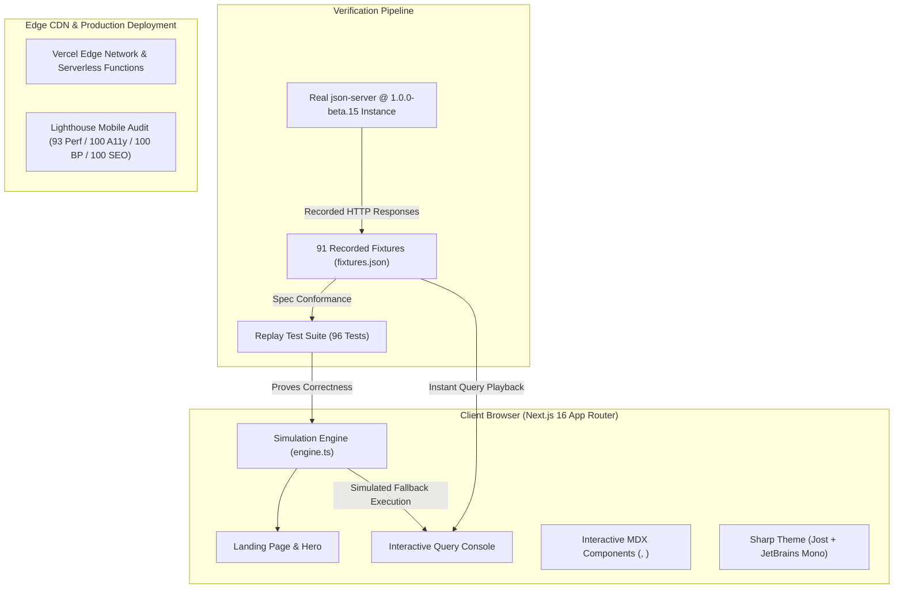

# ⚡ JSON Server Field Guide

<div align="center">

[](https://json-server-field-guide.vercel.app)
[](https://nodejs.org/)
[](https://nextjs.org/)
[](https://www.typescriptlang.org/)
[](LICENSE)

<br/>

**The definitive, empirically verified, example-driven companion for [`json-server@1.0.0-beta.15`](https://github.com/typicode/json-server).**

*Every behavioral claim is backed by a recorded HTTP fixture. Zero guesswork. Zero stale v0.17 copy.*

[Explore Live Guide](https://json-server-field-guide.vercel.app) • [Quickstart (5 Min)](https://json-server-field-guide.vercel.app/quickstart) • [Verification Matrix](https://json-server-field-guide.vercel.app/verification) • [Query Console](https://json-server-field-guide.vercel.app#console)

</div>

---

> [!IMPORTANT]
> **Independent Learning Resource.** This project is an unofficial, independent technical guide and companion authored by **Ebenezer Akinseinde Akindele**. It is not published by or affiliated with the upstream JSON Server project or its maintainers.

---

## 🎯 Why This Project Exists

Thousands of developers reach for `json-server` to mock REST APIs for frontends and tests. However, **`json-server@1.0.0-beta.15` introduced sweeping, undocumented breaking changes from v0.17**:

- Canonical parameters like `_limit`, `_start`, and `_end` were quietly deprecated and now return empty arrays (`[]`).
- POST requests silently ignore custom `id` values provided in the request body.
- Equality filters are strictly case-sensitive, while substring searches require explicit `:contains` modifiers.
- Foreign-key queries fail silently when foreign key identifiers are formatted as strings.

Because tutorials across the internet still teach obsolete v0.17 conventions, developers lose hours debugging mock APIs that fail in unexpected ways.

The **JSON Server Field Guide** solves this with an **empirically audited knowledge base and interactive simulation suite**:
1. **91 Ground-Truth HTTP Fixtures:** Every single claim, error, and return format is captured directly from running `json-server@1.0.0-beta.15` processes on Node 22.
2. **Client-Side Simulation Engine:** A pure TypeScript simulation engine running directly in the browser with 100% fixture parity.
3. **Interactive Honesty Console:** Test and inspect real queries in real time with explicit truth badges (`[Verified Real]`, `[Simulated Query]`, `[Known Beta Gotcha]`).

---

## 🏛️ System Architecture



---

## 🧪 Ground-Truth Gotchas: The Truth Table

Every statement below is proven by an exact fixture recorded in [`src/mdx/fg/fixtures.json`](src/mdx/fg/fixtures.json):

| Query / Feature | Common v0.17 Expectation | Actual `1.0.0-beta.15` Reality | Fixture Reference |
| :--- | :--- | :--- | :--- |
| `?_limit=5&_start=0` | Paginated slice of items | **Returns empty array `[]`** (deprecated) | `qs-filter-empty` |
| `?_page=1&_per_page=5` | Custom header pagination | **Returns envelope:** `{ first, prev, next, last, pages, items, data }` | `qs-paginate` |
| `?_per_page=5` (alone) | Paginated page 1 | **Silently ignored**; returns full unpaginated list | `qs-per-page-only` |
| `POST /tasks` with `{"id": 42}` | Persists item with ID `42` | **Ignores provided ID**; generates random alphanumeric string | `crud-create` |
| `?title=Alpha` vs `?title=alpha` | Case-insensitive match | **Case-sensitive exact match**; mismatched case returns `[]` | `filter-exact` |
| `?title:contains=alpha` | Unsupported operator | **Case-insensitive substring search** | `filter-contains` |
| `?projectId=2` | Resolves foreign key | **Returns `[]` if foreign keys are string-typed** (`"2"`) | `rel-fk-type` |
| `DELETE /projects/1` | Cascades to child tasks | **Does not cascade**; orphaned tasks remain in database | `crud-cascade` |

---

## ✨ Key Features

### 1. In-Browser Interactive Query Console
An art-directed, live query runner embedded directly into the documentation. Select recipes, adjust query parameters, or write custom requests against the task and project database with instant visual feedback and honesty indicators:
- 🟢 **`[Verified Real]`** — The exact request and response were recorded from real `json-server` instances.
- 🟡 **`[Simulated Query]`** — Dynamically computed client-side using our pure TypeScript simulation engine.
- 🔴 **`[Known Beta Gotcha]`** — Highlights specific beta.15 behavior traps where `json-server` deviates from user expectations.

### 2. High-Performance Client Simulation Engine ([`engine.ts`](src/mdx/fg/engine.ts))
- Written in pure TypeScript with zero runtime dependencies.
- Accurately models sorting (`_sort=field`, `-_sort=field`), pagination envelopes, filter operators (`:contains`, `_like`, equality), and parent/child record embedding (`_embed`).
- **Proven against 91 test cases:** 96 automated tests verify 100% equivalence between the simulation engine and real json-server output.

### 3. Art-Directed "Sharp" Design System
- Custom dark-first aesthetic with bespoke Jost typographic hierarchy and JetBrains Mono code styling.
- Responsive from 390px mobile viewports up to 1440px wide-screen displays.
- Full accessibility support: WCAG AA/AAA compliant color contrast, visible focus outlines, keyboard traps prevented, and strict `prefers-reduced-motion` fallbacks.

### 4. Continuous Verification Tooling
Never take documentation claims on faith:
- `scripts/fg-record-fixtures.mjs`: Automated CLI script that spins up a real `json-server` process on Node 22 in a sandboxed temp environment, executes test scenarios, and captures full HTTP requests/responses.
- `scripts/re-execute-commands.mjs`: Automatically re-executes all tutorial commands from the Quickstart and Guide to ensure zero drift.
- `scripts/fg-phase4-audit.mjs`: Automated headless Chrome auditor running Lighthouse, WCAG accessibility checks, and multi-viewport screenshots.

---

## 🏆 Production Audit Scores

Audited with Google Lighthouse (Mobile / Moto G Power emulation) on the production Next.js build:

<div align="center">

| Category | Score | Status |
| :--- | :---: | :---: |
| **Performance** | **93** / 100 | 🟢 High Performance |
| **Accessibility** | **100** / 100 | 🟢 Perfect Score (WCAG AA/AAA) |
| **Best Practices** | **100** / 100 | 🟢 Modern Web Standards |
| **SEO** | **100** / 100 | 🟢 Fully Structured & Discoverable |

</div>

---

## 📂 Repository Layout

```
json-server-field-guide/
├── src/
│   ├── app/                      # Next.js App Router endpoints & routes
│   ├── content/                  # Authored MDX documentation
│   │   ├── introduction.mdx      # Homepage overview & motivation
│   │   ├── quickstart.mdx        # 5-minute practical onboarding
│   │   ├── guides/               # Step-by-step mock API architecture guide
│   │   └── verification.mdx      # Full 91-item claim-to-fixture traceability matrix
│   ├── mdx/
│   │   └── fg/                   # Custom Field Guide feature components
│   │       ├── Console.tsx       # Live interactive query console
│   │       ├── Landing.tsx       # Art-directed hero & walkthrough cards
│   │       ├── TryIt.tsx         # Inline interactive request previewer
│   │       ├── Verified.tsx      # Honest verification pill badge
│   │       ├── engine.ts         # Pure TypeScript query simulation engine
│   │       ├── engine.test.ts    # 96-step fixture verification test suite
│   │       ├── fixtures.json     # 91 ground-truth HTTP request/response pairs
│   │       └── fg.css            # Scoped design tokens, glow effects & animations
│   ├── data/site.ts              # Global brand configuration & site metadata
│   └── middleware.ts             # Edge middleware for content negotiation & machine discovery
├── docs.json                     # Documentation structure, navigation, and theme definitions
├── scripts/
│   ├── fg-record-fixtures.mjs    # Ground-truth HTTP fixture recorder
│   ├── fg-phase4-audit.mjs       # Headless Lighthouse and accessibility auditor
│   └── re-execute-commands.mjs   # Tutorial command validation runner
└── notes/
    ├── critique.md               # Awwwards-style design critique & refinement rubric
    ├── friction-log.md           # Developer experience and platform observations
    └── vercel-fallback.md        # Production edge deployment runbook
```

---

## 🚀 Quick Start & Local Development

### Prerequisites
- **Node.js**: `v22.12.0` or newer (matching json-server's engine requirements)
- **npm**: `v10.9.0` or newer

### 1. Clone & Install
```bash
git clone https://github.com/Ebendttl/json-server-field-guide.git
cd json-server-field-guide

# Ensure Node 22 is active
source ~/.nvm/nvm.sh && nvm use 22

# Install dependencies
npm install
```

### 2. Start Development Server
```bash
npm run dev
```
Open [http://localhost:3040](http://localhost:3040) in your browser.

### 3. Run Quality & Verification Suites
```bash
# Verify the pure TypeScript engine against all fixtures (96 tests)
npm run test:engine

# Re-verify ground-truth HTTP fixtures against a live json-server
npm run verify:fixtures

# Run Thally content validation and broken-link audit
npm run check -- --ci

# Run production TypeScript typecheck and Turbopack build
npm run typecheck && npm run build
```

---

## 🧭 Machine-Readable & Agent Discovery

This guide is built to be first-class for AI agents and automated tools:
- **LLM Full Context:** [`/llms.txt`](https://json-server-field-guide.vercel.app/llms.txt) and [`/llms-full.txt`](https://json-server-field-guide.vercel.app/llms-full.txt)
- **Agent Skill Definition:** [`/skill.md`](https://json-server-field-guide.vercel.app/skill.md)
- **Content-Negotiation:** Append `.md` to any documentation URL (e.g., `/quickstart.md`) to retrieve raw, clean Markdown.

---

## 👤 Author & Acknowledgments

Created with passion and engineering discipline by:

**Ebenezer Akinseinde Akindele**  
GitHub: [@Ebendttl](https://github.com/Ebendttl)

Special thanks to:
- [typicode](https://github.com/typicode) for creating and maintaining `json-server` over the past decade.
- The [Thally](https://github.com/thallylabs/thally) documentation framework team.

---

## 📄 License

This repository is licensed under the [MIT License](LICENSE).
